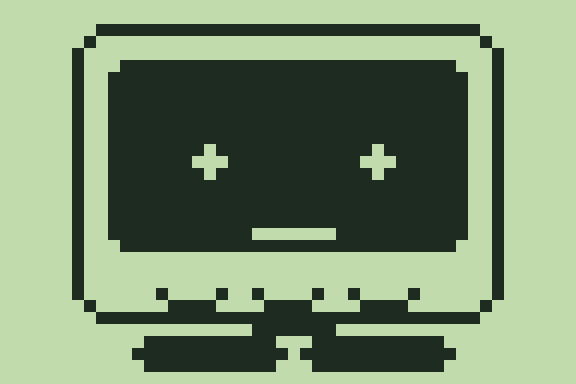

# VMU Stack-chan

A small standalone companion for the Sega Dreamcast Visual Memory Unit (VMU), inspired by Stack-chan and M5Stack-Avatar. It renders 32 monochrome animation frames at 48 × 32 pixels and responds to A, B, and the directional buttons.

[日本語の説明](README_ja.md)



The companion runs on the VMU. The Dreamcast is used to transfer the VMU program; this repository does not contain a native Dreamcast port of the companion, network access, or an LLM.

## Current status

The local LC86K smoke test exercises LCD RAM copying, idle animation, blinking, and six button reactions. It is a small interpreter, not a complete VMU hardware emulator.

**Physical Dreamcast installation and VMU execution remain unverified.** The original Data/Data disc image reaches the Sega license screen and then the VMU Disc Builder menu in Flycast 2.7 with HLE BIOS. The user's Japanese, MIL-CD-capable Dreamcast returns to its system menu before the Sega license screen. PC read-back verification passed, but does not establish console compatibility.

A later experimental Audio/Data remaster stalls at the Sega license screen in both Flycast and the user's Dreamcast. That remaster is not a working replacement and is not included. See [the boot investigation](docs/boot-status.md) for the evidence and remaining questions.

## Files

- `make_art.py`: generates the animation frames, icon, and previews using Pillow.
- `build_vms.py`: assembles the LC86K program and packages VMS/VMI files using Python's standard library.
- `stackchan.s`: generated assembly listing; the assembly template is maintained in `build_vms.py`.
- `smoke_test.py`: limited LC86K interpreter and animation/input smoke test.
- `STACKCHN.VMS` and `STACKCHN.VMI`: the original small VMU payloads from the source package.
- `build_cdi_windows.ps1` and `BUILD_CDI.bat`: retrieve upstream VMU Disc Builder v1.1 and create a Data/Data CDI on Windows.
- `THIRD_PARTY_NOTICES.txt`: existing attribution and notices.

## Build and test the VMU program

Use Python 3 with Pillow installed:

```powershell
python -m pip install Pillow
python make_art.py
python build_vms.py
python smoke_test.py
```

`build_vms.py` generates `symbols.json`, which the smoke test requires. These commands regenerate the local assets and VMU payloads.

## Build the Dreamcast transfer disc

On Windows, run:

```powershell
.\BUILD_CDI.bat
```

The wrapper downloads and executes the upstream [VMU Disc Builder v1.1](https://github.com/DerekPascarella/VMU-Disc-Builder/releases/tag/1.1). Its downloaded tools and browser assets remain outside Git. The default includes a dummy file for a roughly 550 MiB filesystem, so the resulting CDI is large. The output is `VMU_STACKCHAN.cdi`.

This creates an experimental transfer disc; it does not fix the unresolved physical-console boot failure. The wrapper does not burn a CD or install the program on hardware. Preserve the original Data/Data structure when investigating it; changing the session layout requires validation of the browser/bootstrap pairing.

## Attribution

This is an unofficial fan adaptation. Stack-chan and M5Stack-Avatar are separate upstream projects. Existing attribution is preserved in [THIRD_PARTY_NOTICES.txt](THIRD_PARTY_NOTICES.txt). VMU Disc Builder, its browser assets, disc images, firmware dumps, and emulator binaries are not bundled here.
