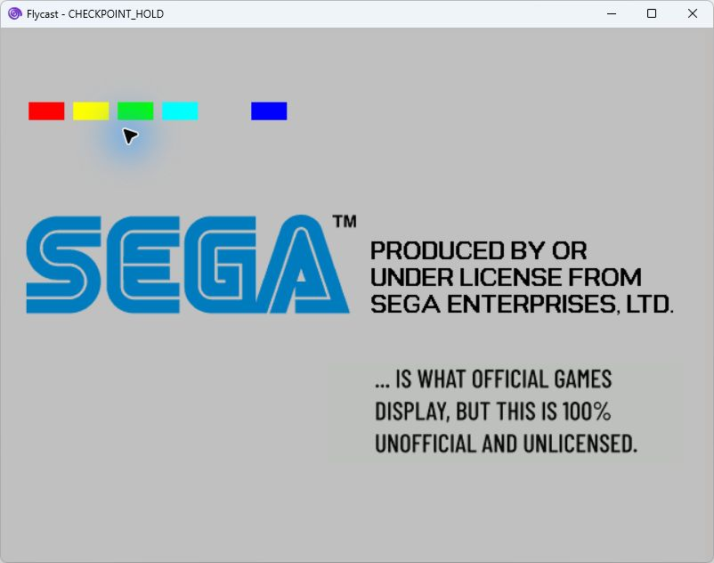
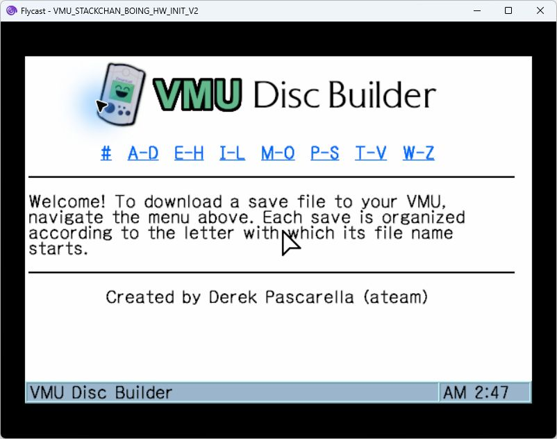
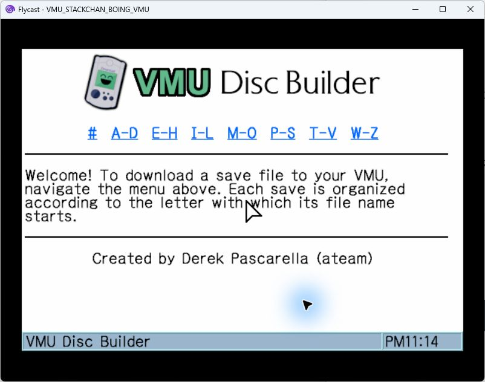

# BOING boot loader with the VMU transfer browser

The optional `--hardware-startup` Audio/Data candidate reaches the VMU Disc Builder browser in Flycast 2.7 using its HLE BIOS and passes structural and all 85 payload-file checks. Its disc license code and boot loader match the confirmed-working BOING reference byte for byte. Physical Dreamcast boot and VMU transfer remain pending. The previous minimal candidate was burned and verified, but reached the Sega screen and froze on the physical Japanese Dreamcast.

## What changed

The original browser expects a GD-ROM drive classification. With BOING's normal `CD-ROM1/1` header, Flycast reports the actual CD class and the unmodified browser stalls at the Sega license screen. A controlled Data/Data diagnostic changed only the header's `C` to `G` and reached the browser. That diagnostic did not regenerate sector checksums and must never be burned.

Both startup modes keep BOING's CD header and bootstrap. A small entry adapter wraps only successful GD-ROM drive-status requests. It converts loaded CD-ROM, CD-XA, or CD-i classifications to the GD-ROM class expected by the browser. It preserves error, busy, absent-disc, open-tray, and audio-only responses. The browser then resumes at its original entry offset `0x0C`.

The Audio/Data layout also requires the browser's primary-volume-descriptor FAD to change from `166` to `11868`. This changes one little-endian word at raw executable offset `0x282CF0`. Other constants with value 166 are unchanged: one is a Java opcode, another is an offset within the volume descriptor. mkdcdisc already relocates the actual CDI's ISO extents for session LBA `11702`; its optional standalone ISO dump deliberately has base zero.

The runtime wrapper is copied to `0xAC00B900`, within BOING's consumed MR image source, before entering the browser. This avoids both BIOS-shadow RAM and the browser's BSS clearing range. The bootstrap bytes recorded on disc are unchanged. The browser startup adapter is appended at `0xAC2BD8E4`; it runs before startup clears that region.

The drive-class experiment establishes the cause of the unadapted replacement image's **HLE emulator stall**. It does not establish the physical console's later startup failure. The original Data/Data disc's rejection before the Sega logo also remains untraced.

## Optional hardware startup

BOING's KOS application performs GD-ROM initialization and unlocking after the shared IP bootstrap. Copying that bootstrap alone does not copy the application's KOS startup. The minimal adapter omitted the original browser loader's corresponding setup. Missing initialization is a hypothesis for the console freeze, not a proven physical cause; successful HLE boot can hide a hardware dependency.

`--hardware-startup` selects `boot_shim_hardware.S` with `VMU_FULL_GD_SETUP=1` and links `framebuffer_checkpoint.S`. It restores the original loader's Holly GD-ROM unlock write, full boot-ROM read, two guarded BIOS RAM patch searches, and GD-ROM initialization. Initialization polls have a fixed budget; failed requests, failed status, and timeout stop at a diagnostic checkpoint rather than continuing into the browser.

This mode also guards the original cached target `0x8C1DC360` at raw offset `0x2C` and replaces it with the linked `_shim_cache_entry` P2 alias. The thunk executes eight NOPs after the native cache-control prologue, emits checkpoint 6, and then jumps to the original target. The target must lie within the appended shim. Only the initial 12 entry bytes, that four-byte cache target, and the PVD word at `0x282CF0` may change in the original executable; the shim is appended. The build extracts only `.text`, rejects shims larger than 8192 bytes before reading them, and records the startup mode, source/helper hashes, and guarded target in its manifest.

The helper draws cumulative color blocks into the existing framebuffer without selecting a new video mode. Checkpoint numbers describe marker slots; the internal diagnostic state uses a separate set of values.

| Marker | Color | Reached point |
|---|---|---|
| 1 | Red | Entry adapter entered |
| 2 | Yellow | GD-ROM initialization completed |
| 3 | Green | Runtime drive-status wrapper installed |
| 4 | Cyan | Handoff to the native browser prologue is imminent |
| 5 | Magenta | Initialization failed or timed out; execution stops |
| 6 | Blue | P2 thunk reached after the native cache-control prologue |

The normal path draws markers 1, 2, 3, 4, and 6, leaving the failure slot empty. A marker proves the point at which it is drawn; blue does not prove that the following native CRT entry executed. A separate HLE-only `CHECKPOINT_HOLD` control stops in the final thunk and visibly renders red, yellow, green, cyan, an empty failure slot, and blue over the Sega screen. This confirms marker rendering in the emulator control. Marker visibility and interpretation on the physical console remain pending.



## Reproduce

Python 3.11 or newer, Ubuntu WSL, the SH4 binutils toolchain, and mkdcdisc are required. The scripts accept native Linux execution and custom paths through `--native`, `--toolchain-prefix`, `--mkdcdisc`, and `--mkdcdisc-source`.

Use a local extracted VMU browser directory containing `1ST_READ.BIN`, `DP2.INI`, and the `DP*` directories. The audited raw browser is 2,808,036 bytes with SHA-256 `f43d637858be93cef87da0fd9045e9cf8c1ef9a288bb15b808bee360fb997b1e`. Other browser revisions are rejected. No browser executable, BIOS, or CDI is distributed in this repository.

The mkdcdisc source must be clean at BOING's builder commit `2b98b0d9480e364e3517355648fbc3b49fb19882`. The executable hash is recorded separately; source revision checking does not prove how an arbitrary executable was built.

Current hardware-startup candidate:

```powershell
python tools/build_boing_disc.py EXTRACTED_BROWSER NEW_HARDWARE_OUTPUT.cdi --layout audio-data --hardware-startup
python tools/prepare_browser.py EXTRACTED_BROWSER EXPECTED_HARDWARE_RAW.bin --layout audio-data --hardware-startup
python tools/validate_boing_disc.py --image NEW_HARDWARE_OUTPUT.cdi --boing-reference BOING.cdi --source-dir EXTRACTED_BROWSER --adapted-raw EXPECTED_HARDWARE_RAW.bin --report hardware-validation.json
python -m unittest discover -s tools/tests -v
```

Omitting `--hardware-startup` preserves the minimal mode for historical reproduction. That candidate passed HLE boot but failed on the physical console; repeating its unchanged burn does not test the new startup path.

```powershell
python tools/build_boing_disc.py EXTRACTED_BROWSER NEW_MINIMAL_OUTPUT.cdi --layout audio-data
python tools/prepare_browser.py EXTRACTED_BROWSER EXPECTED_MINIMAL_RAW.bin --layout audio-data
```

Outputs must be outside the input directory. Existing images, logs, and manifests are never overwritten. The builder excludes the original `0.0` dummy, `IP.BIN`, and `1ST_READ.BIN`, supplies the adapted raw executable to mkdcdisc for scrambling, and preserves every remaining file and relative path. The resulting image retains mkdcdisc's normal disc padding.

## Evidence

Current local hardware-startup candidate: `VMU_STACKCHAN_BOING_HW_INIT_V2.cdi`, 740,246,665 bytes, SHA-256 `bc37e22f5eea580ed54ae4a9b927504feeb748d1a0e62d944cb2bea98aee14d9`.

| Check | Result |
|---|---|
| BOING license code, Japan slot, and bootstrap | Identical to reference |
| Disc structure and session extents | Passed; Audio/Data, session LBA 11702, browser PVD FAD 11868 |
| Recorded main executable | Descrambles to hardware-adapted raw SHA-256 `e42c5a9c2e0910dfab115a3f2fe1e1ec43582bff7cd091ef88b5502f448ab632` |
| Browser and payload files | All 85 match the extracted source |
| Flycast 2.7 HLE BIOS | VMU browser reached |
| Checkpoint renderer | Visible in separate HLE hold control |
| Original BIOS emulator test | Not performed; no BIOS dump supplied |
| Physical Dreamcast boot | Pending |
| VMU transfer and standalone VMU operation | Pending |



Previous minimal candidate: `VMU_STACKCHAN_BOING_VMU.cdi`, 740,246,665 bytes, SHA-256 `d4bfb03d97cc4b21ab2fbe13287f1c61978375b810f3bc35215e3fcd8bf337c3`.

| Check | Result |
|---|---|
| BOING license code `IP[0x300:0x3700]` | Identical |
| Japan license slot `IP[0x3700:0x3740]` | Identical; Japan enabled |
| BOING bootstrap `IP[0x3800:0x8000]` | Identical |
| Disc header | `CD-ROM1/1`, `JUE`, `1ST_READ.BIN` |
| Layout | Two sessions; Audio/Data; data starts at LBA11702 |
| Actual CDI path/root extents | 11736 / 11721 |
| Browser PVD FAD | 11868 |
| Recorded main executable | Descrambles to adapted raw SHA-256 `0ede416ea21c3f5314ba8800d37eb607b210158d7cfb95d46494b0560c08e8b0` |
| Browser and payload files | All 85 match the extracted source |
| `STACKCHN.VMS` | Original SHA-256 `a353ad9a1d69ee535c6859672a512fac1c6f2b1286a2816dcf116be0516d36dc` |
| `STACKCHN.VMI` | Original SHA-256 `95a9d009a13be7e7deb955916e0ec767f451a892803421467eca8339fd7f070b` |
| Flycast 2.7 HLE BIOS, Japan, composite | VMU browser reached |
| CD-R write and ImgBurn read-back | Passed at 10x SAO; both sessions match the candidate; zero read errors or mismatches |
| Original BIOS emulator test | Not performed; no BIOS dump supplied |
| Physical Japanese Dreamcast | Failed: Sega screen, then freeze before browser |
| VMU transfer | Not reached |



The 14 tool regression tests pass, including hardware patch preservation, linked target bounds, oversize rejection before reading, and preservation of minimal-mode behavior. Earlier complete repository-tool builds passed for both Audio/Data and Data/Data; the Audio/Data result also passed structural validation. The validator rejects the previous unadapted BOING Audio/Data candidate because its executable and PVD FAD do not match the adapter. Data/Data tool-build success alone is not emulator or console acceptance.

## Next investigation

The next physical test is the new hardware-startup candidate. Reaching the Sega screen narrows the previous failure to the subsequent startup path, but does not prove the browser main entry executed. The user's identification of a modified logo is uncertain; the logo alone does not establish execution of the new entry adapter.

Record any visible checkpoint colors and whether the browser appears. A successful console browser test must be followed by VMU transfer and standalone VMU checks before declaring the issue resolved. This remains a draft investigation; restoring initialization and hardening the cache transition do not yet establish the cause of the physical freeze.

## Primary references

- [Flycast v2.7 drive-status implementation](https://github.com/flyinghead/flycast/blob/v2.7/core/reios/gdrom_hle.cpp): the HLE drive type depends on the IP header's GD-ROM classification.
- [Dreamcast system-call documentation](https://mc.pp.se/dc/syscalls.html): GD-ROM status call and output fields.
- [Dreamcast IP.BIN boot documentation](https://mc.pp.se/dc/ip.bin.html): boot/license stages and executable scrambling.

Refs #2.
