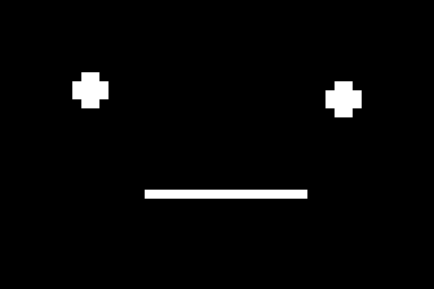
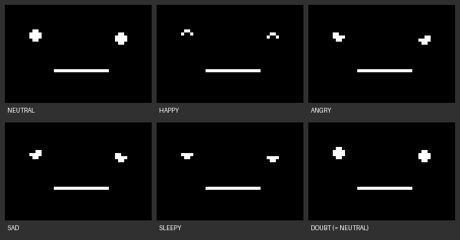

# Stack-chan Face for VMU

A separate, face-only version with the ebazchan expression family: Neutral, Happy, Angry, Sad, Sleepy and Doubt. It automatically changes expressions, blinks, shifts its gaze, breathes, tilts and animates the mouth. The LCD contains no robot body, text, border or speech bubbles. A/B and the directional pad leave the automatic display alone; MODE returns to the VMU menu, and SLEEP uses the existing sleep path.

The original `STACKCHN.VMS` program stays unchanged. This variant is `FACECHAN.VMS` with matching `FACECHAN.VMI` download metadata. It reuses the original program's now-confirmed startup, interrupt trampoline, LCD copying and system-button handling. New physical acceptance is recorded separately.



The earlier 4-block blink-only build remains in its original local release files. The current build retains the requested expression and movement variations. Its generated manifest records the actual size, hashes, sprite bank and animation schedule. New physical VMU acceptance remains pending.

The expression edition is 7,680 bytes (15 VMU blocks), with 31 deduplicated sprites and 192 scheduled ticks. VMS SHA-256: `206ec7732eb6eb3e914a9a7026d7f138ccc704dbcbb250b9008ce11d25dd8563`.



## Face reference

The artwork comes from the procedural look of the ebazchan `samples/stackchang_face` demo, based on [m5stack-avatar](https://github.com/meganetaaan/m5stack-avatar) (MIT, Copyright 2018 Shinya Ishikawa). That reference uses two circles and a rectangular mouth, rather than a bitmap asset. The neutral 240×240 scene has eye centers (50,93)/(190,96), radius 8, and a 90×4 mouth centered at (123,148). Closed eyes become 16×4 bars.

Happy keeps an upper crescent after cutting the inner circle and lower half. Angry and Sad cut opposite triangles from the upper eye regions; Sleepy retains the lower circular segment. Doubt intentionally shares Neutral's round eye shape in the source. The mouth is always rectangular: it becomes narrower and taller when open, never a curved smile or frown.

Scene positions and mouth geometry scale uniformly by one fifth, cropping unused top/bottom margins at source rows 40–199. The tiny eyes use optically adjusted 4×4 glyphs so the same crescent or slope remains visible in both eyes; directly shrinking the source made one crescent collapse to a line. These glyphs are an LCD adaptation, not pixel-identical source shapes. Gaze, breathing and whole-face tilt still move the face. LCD dark pixels form the background and clear pixels form the face. The upstream notice and the runtime's third-party notices are in [THIRD_PARTY_NOTICES.txt](../THIRD_PARTY_NOTICES.txt).

The original independently timed random motions are adapted to a deterministic 192-tick loop so every expression appears. Each expression has 32 ticks: rest, blink, left/right gaze with breathing and tilt, then a closed-to-open-to-closed mouth sequence. Sprite bytes are deduplicated without dropping expression stages. The GIF uses the same timeline and sprites as the VMU; its display duration is illustrative, not a hardware timing measurement.

## Build and validate

Python 3.11+ and Pillow are required. From the repository root:

```powershell
python face/build_face.py NEW_FACE_OUTPUT_DIR
python face/test_face.py NEW_FACE_OUTPUT_DIR
```

The output directory contains the VMS/VMI, generated assembly and frame bytes, animation timeline, symbol table, manifest, save icon and actual-pixel previews. `expressions.png` labels the six resting expressions outside the LCD images. Existing generated files are preserved. This command does not rebuild or overwrite the original program.

The bounded interpreter checks actual LC86K execution, complete LCD writes and timeline wraparound. It does not emulate the VMU BIOS, interrupts, real display timing or physical power consumption. MODE, docking and sleep tests check control flow only.

## Transfer disc

Use the same original extracted browser directory and BOING reference used for the confirmed working transfer image:

```powershell
python face/build_disc.py NEW_FACE_OUTPUT_DIR EXTRACTED_BROWSER NEW_FACE_DISC.cdi --boing-reference BOING.cdi
```

This wrapper stages a temporary browser tree, adds FACECHAN, and makes its download the home-page link. It preserves the original Stack-chan payload under the original P–S page. The disc uses the confirmed Audio/Data hardware-startup path. It validates the actual CDI against the expected executable, bootstrap and all staged files before recording success. The accompanying base-zero ISO is an inspection artifact; burn the CDI.

Select **Download face to VMU**, choose a VMU and wait for save completion. Remove the VMU from the controller, press SLEEP, choose Game using MODE, then press A. Standalone operation requires working VMU batteries.

The original program has user-confirmed physical boot and transfer. A successful build, interpreter test or Flycast browser test does not establish physical acceptance of this new variant.
